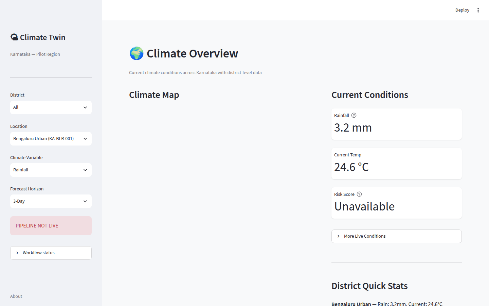

<div align="center">

# 🌍 Climate Digital Twin

**AI-Powered Climate Digital Twin for India**

*Real-time climate monitoring, multi-model forecasting, scenario simulation, and risk assessment — powered by a microservices architecture and an interactive Streamlit dashboard.*

[](https://www.python.org/downloads/)
[](https://fastapi.tiangolo.com)
[](https://streamlit.io)
[](LICENSE)
[](https://docs.docker.com/compose/)
[](https://github.com/ShibilAhamed701212/climate_digital_twin/actions/workflows/ci.yml)
[](CHANGELOG.md)

</div>

---

## 📖 Overview

Climate Digital Twin is a full-stack platform that creates a **digital replica of India's climate system**, focused on the Karnataka region. It ingests real-time weather data from multiple providers (Open-Meteo, NASA POWER, IMD), runs physics-informed simulations, generates multi-horizon forecasts using an ensemble of deep learning models, and provides actionable climate risk assessments — all accessible through a rich interactive dashboard and a RESTful API gateway.

### Key Capabilities

| Capability | Description |
|---|---|
| **🔄 Digital Twin State** | Versioned, observable replica of regional climate state with real-time data synchronization |
| **📈 Multi-Model Forecasting** | Ensemble of 8 model architectures (LSTM, Transformer, XGBoost, Prophet, Baseline, plus simplified implementations inspired by iTransformer, PatchTST, and TimeMixer) |
| **🔮 Scenario Simulation** | Monte Carlo simulation engine with perturbation models for what-if climate scenarios |
| **⚠️ Climate Risk Assessment** | Automated heat, flood, and drought risk scoring with deterministic feature attribution |
| **📚 Knowledge Base (RAG)** | FAISS vector store with hybrid semantic + BM25 search over climate documents |
| **🤖 AI Copilot** | Conversational AI assistant powered by Ollama (Qwen 3) for natural-language climate queries |
| **🗺️ Spatial Analysis** | Grid-based twin with coupled simulation processes (evapotranspiration, runoff, soil water, SPEI drought) |
| **📊 Interactive Dashboard** | 11-page Streamlit dashboard with real-time charts, maps, Folium spatial views, and disaster intelligence |

---

## 🏗️ Architecture

The platform follows a **microservices architecture** with 10 containerized services communicating over an internal Docker network:

```
┌──────────────────────────────────────────────────────────────────────┐
│                        Streamlit Dashboard (:8501)                    │
│  Climate Overview │ Forecasts │ Twin State │ Scenarios │ Risk │ Disaster │ ...  │
└──────────────────────┬───────────────────────────────────────────────┘
                       │
                       ▼
┌──────────────────────────────────────────────────────────────────────┐
│                    FastAPI Gateway (:8000)                            │
│  /twin  /forecast  /scenario  /risk  /rag  /feedback  /health  /disaster    │
└──┬──────────┬──────────┬──────────┬──────────┬──────────┬────────────┘
   │          │          │          │          │          │
   ▼          ▼          ▼          ▼          ▼          ▼
┌──────┐ ┌────────┐ ┌────────┐ ┌──────┐ ┌──────┐ ┌──────────┐
│ Twin │ │Forecast│ │Scenario│ │ Risk │ │ RAG  │ │ Copilot  │
│ State│ │ Engine │ │ Engine │ │Engine│ │Service│ │  Agent   │
│:8001 │ │ :8006  │ │ :8002  │ │:8003 │ │:8004 │ │  :8005   │
└──────┘ └────────┘ └────────┘ └──────┘ └──────┘ └────┬─────┘
                                                       │
                                                  ┌────▼─────┐
                                                  │  Ollama  │
                                                  │ :11434   │
                                                  └──────────┘
```

**Supporting Services:** Report Service (:8007) · Disaster Intelligence (:8008, Compose profile `disaster`; optional `docker-compose.gpu.yml`) · Redis (optional) · Prometheus + Grafana (monitoring profile)

---

## 🚀 Quick Start

### Prerequisites

- **Python 3.11+**
- **Docker & Docker Compose** (for containerized deployment)
- **4 GB+ RAM** (8 GB recommended for full stack with Ollama)

### Option 1 — Local Development

```bash
# 1. Clone the repository
git clone https://github.com/ShibilAhamed701212/climate_digital_twin.git
cd climate_digital_twin

# 2. Create and activate a virtual environment
python -m venv venv
source venv/bin/activate      # Linux/macOS
venv\Scripts\activate         # Windows

# 3. Install dependencies
pip install -e ".[dev]"

# 4. Copy environment configuration
cp .env.example .env

# 5. Start the API gateway
uvicorn backend.api.main:app --host 0.0.0.0 --port 8000 --reload

# 6. Start the dashboard (in a separate terminal)
streamlit run dashboard/app.py
```

### Option 2 — Docker Compose (Full Stack)

```bash
# Build and start all services
make up

# Or manually:
docker compose up --build -d

# Access the services:
#   Dashboard:        http://localhost:8501
#   API Gateway:      http://localhost:8000
#   API Docs:         http://localhost:8000/docs
```

### Option 3 — Local Services Scripts (no Docker)

```bash
# Linux/macOS: starts the 8 FastAPI services + dashboard on 127.0.0.1,
# writes logs/PIDs to logs/local/ and prints a health check
bash start_local.sh
```

```powershell
# Windows
.\start_local.ps1                     # or .\scripts\start_local_services.ps1
```

Ollama is not started by these scripts; the AI Copilot answers only when an Ollama server with the configured model (`OLLAMA_MODEL`, default `qwen3:4b`) is reachable.

---

## 🖥️ Dashboard

The Streamlit dashboard (`dashboard/app.py`) has 11 pages selected from the sidebar: Climate Overview, Forecast Viewer, Digital Twin State, Scenario Simulator, Climate Risk, Reports & Insights, AI Copilot, Knowledge Base, Spatial Grid, Feedback and Disaster Intelligence.



*Captured from a local `start_local.sh` run with no live ingestion pipeline (hence "PIPELINE NOT LIVE"). Values come from the synthetic dataset generated by `scripts/download_data.py --dataset synthetic`; the map is blank because tile servers were unreachable in the capture environment.*

---

## 📁 Project Structure

```
climate-digital-twin/
│
├── backend/                  # FastAPI API gateway & route handlers
│   ├── api/                  #   Routes: twin, forecast, scenario, risk, rag, feedback, disaster
│   ├── core/                 #   Shared backend utilities
│   └── services/             #   Forecast inference service
│
├── climatedt/                # Core domain library (facade package)
│   ├── simulation/           #   Coupled simulation engine (Penman-Monteith ET, SCS runoff, SPEI)
│   ├── spatial/              #   Grid-based twin & spatial operations
│   ├── ml/                   #   Machine learning utilities
│   ├── twin/                 #   Twin state management
│   ├── risk/                 #   Risk service facade
│   ├── rag/                  #   RAG service facade
│   └── ...                   #   forecast, scenario, feedback, data, integrity, storage
│
├── simulator/                # Digital twin simulation engine
│   ├── engine/               #   Monte Carlo, perturbation, scenario, twin engines
│   ├── scenarios/            #   Scenario generation, comparison, ensemble analysis
│   ├── entities/             #   Climate entity models
│   ├── graph/                #   Entity graph for spatial relationships
│   ├── synchronizer/         #   Real-time data synchronization with twin state
│   ├── reconciliation/       #   Observation-simulation reconciliation
│   └── ...                   #   anomaly, conflict, events, historical, validators
│
├── models/                   # ML forecasting models
│   ├── lstm/                 #   LSTM recurrent model
│   ├── transformer/          #   Vanilla Transformer model
│   ├── itransformer/         #   Inverted Transformer (iTransformer)
│   ├── patchtst/             #   Patch Time Series Transformer
│   ├── timemixer/            #   TimeMixer architecture
│   ├── xgboost/              #   XGBoost gradient boosting
│   ├── prophet/              #   Facebook Prophet
│   ├── baseline/             #   Statistical baseline model
│   ├── ensemble/             #   Ensemble aggregation
│   ├── registry/             #   Model registry & versioning
│   └── tuning/               #   Hyperparameter tuning
│
├── risk/                     # Climate risk assessment engine
│   ├── scoring/              #   Heat, flood, drought, and composite risk scoring
│   ├── explainability/       #   Deterministic feature attribution (SHAPExplanation schema)
│   ├── evaluation/           #   Hazard evaluator, alert policies, quality gates
│   ├── models/               #   Risk data models (hazard assessments)
│   └── store/                #   Alert & hazard persistent stores
│
├── knowledge/                # RAG knowledge base
│   ├── retriever/            #   Hybrid search (semantic + BM25), context builder
│   ├── embeddings/           #   Sentence-transformer embeddings
│   ├── vector_store/         #   FAISS index management
│   ├── chunkers/             #   Document chunking strategies
│   ├── loaders/              #   Document loaders (Markdown, CSV, JSON)
│   ├── pipelines/            #   Indexing pipeline
│   └── documents/            #   Climate knowledge documents (IMD, ISRO, govt, research)
│
├── copilot/                  # AI Copilot assistant service
│   ├── agent/                #   Intent classification agent
│   ├── planner/              #   Query planning & tool selection
│   ├── workflows/            #   Orchestrator, executor, response generator
│   ├── tools/                #   Forecast, risk, RAG, scenario, twin, report tools
│   ├── llm/                  #   Ollama LLM client
│   ├── memory/               #   Conversation memory
│   └── prompts/              #   System & tool prompt templates
│
├── disaster_intelligence/    # Disaster Intelligence Engine (SAR threshold + OSM overlays)
│   ├── domain/               #   Entities, flood/OSM/zonal rules
│   ├── application/          #   Jobs, ingest, assessment
│   ├── adapters/             #   STAC, JSONL, GeoJSON OSM, twin HTTP
│   └── api/                  #   Origin FastAPI :8008
│
├── pipeline/                 # Data ingestion & processing pipeline
│   ├── providers/            #   Open-Meteo, NASA POWER, IMD data providers
│   ├── sources/              #   Location registry & data source management
│   ├── stores/               #   Observation & rejected data stores
│   └── functions/            #   Pipeline function utilities
│
├── dashboard/                # Streamlit interactive dashboard
│   ├── page_views/           #   11 page modules (overview, forecast, twin, scenarios, ...)
│   ├── components/           #   Sidebar, navigation, reusable UI components
│   ├── services/             #   API client for backend communication
│   ├── charts/               #   Chart rendering utilities
│   ├── maps/                 #   Folium map components
│   └── assets/               #   CSS styling & static assets
│
├── config/                   # Runtime configuration files
├── data/                     # Data storage (raw, processed, twin store, scenarios)
├── deployment/               # Docker, CI/CD, monitoring, and health checks
│   ├── docker/               #   11 Dockerfiles (one per service, incl. Ollama and disaster engine)
│   ├── monitoring/           #   Prometheus & Grafana configuration
│   ├── health/               #   Health check scripts
│   └── scripts/              #   Deployment helper scripts
│
├── scripts/                  # Operational scripts (seeding, indexing, verification, smoke checks)
├── tests/                    # Test suite (unit + integration, ~80% line coverage)
├── wiki/                     # GitHub Wiki source pages
│
├── docker-compose.yml        # Full-stack Docker Compose (10 services)
├── docker-compose.prod.yml   # Production compose overrides
├── Makefile                  # Developer workflow commands
├── pyproject.toml            # Python project configuration & dependencies
└── LICENSE                   # MIT License
```

---

## 🧠 Forecasting Models

The platform implements **8 forecasting architectures** with automated training, evaluation, and ensemble aggregation:

| Model | Type | Description |
|---|---|---|
| **LSTM** | Deep Learning | Long Short-Term Memory for sequential climate patterns |
| **Transformer** | Deep Learning | Self-attention based temporal modeling |
| **iTransformer** | Deep Learning | Inverted Transformer — treats variables as tokens |
| **PatchTST** | Deep Learning | Patch-based Time Series Transformer |
| **TimeMixer** | Deep Learning | Multi-scale temporal mixing architecture |
| **XGBoost** | Gradient Boosting | Tabular gradient boosting with feature engineering |
| **Prophet** | Statistical | Facebook Prophet for trend + seasonality decomposition |
| **Baseline** | Statistical | Persistence and climatology baselines |

**Ensemble:** Weighted model aggregation with physics-informed consistency checks.

---

## ⚠️ Risk Assessment

The risk engine provides multi-hazard climate risk scoring:

- **🌡️ Heat Risk** — Consecutive hot days, seasonal anomaly detection, threshold exceedance
- **🌧️ Flood Risk** — Rainfall intensity, multi-day accumulation, forecast uncertainty
- **☀️ Drought Risk** — Rainfall deficit, dry period duration, temperature stress
- **📊 Composite Risk** — Weighted aggregation across all hazard types
- **🔍 Explainability** — Deterministic rule-based feature attribution for every risk score (not KernelSHAP)

---

## 🔮 Scenario Simulation

The scenario engine supports interactive what-if analysis:

- **Monte Carlo Engine** — Stochastic ensemble simulation with configurable sample sizes
- **Perturbation Models** — Temperature offsets, rainfall multipliers, extreme event injection
- **Scenario Comparison** — Side-by-side comparison of baseline vs. perturbed futures
- **Ensemble Analysis** — Statistical aggregation across Monte Carlo runs

---

## 📚 Knowledge Base (RAG)

The Retrieval-Augmented Generation system provides domain-specific climate knowledge:

- **Document Sources** — IMD weather data, ISRO satellite observations, government reports, risk assessments, research papers
- **Hybrid Search** — Combines FAISS semantic search with BM25 keyword matching
- **Sentence Embeddings** — Powered by `sentence-transformers` for dense retrieval
- **Context Builder** — Assembles relevant context for the AI Copilot

---

## 🛠️ Development

### Running Tests

```bash
pip install -e ".[dev]"
python scripts/download_data.py --dataset synthetic   # seed local datasets (as CI does)
make test                                             # = pytest tests/ -v
```

`pytest.ini` always measures coverage and fails the run below **80%** (`--cov-fail-under=80`). At the time of writing the suite has ~2,900 tests and sits just above that line. Some tests skip on purpose:

- `tests/integration/test_dashboard_pages.py` needs Playwright and a dashboard running on `localhost:8501`.
- Tests for `simulator/outputs`, `copilot/reports` and `knowledge/reports` skip because those source packages were excluded by `.gitignore` and never committed.
- The real-data manifest check needs `data/real/dataset_manifest.json`, which only exists after the real ingestion pipeline has run.

CI (`.github/workflows/ci.yml`) runs gitleaks, `ruff check` + `ruff format --check`, mypy on `disaster_intelligence`, the OpenAPI contract check, `docker compose config`, `pip-audit` (non-blocking), the test suite on Python 3.11 and 3.12, and Docker builds of six service images.

### Linting

```bash
make lint

# Or directly:
ruff check .
```

### Useful Make Commands

| Command | Description |
|---|---|
| `make install` | Install Python dependencies (dev) |
| `make test` | Run all tests |
| `make cov` | Run tests with an XML + terminal coverage report |
| `make lint` | Run ruff linter |
| `make format` | Format code with ruff |
| `make validate` | mypy (disaster_intelligence), OpenAPI contract, compose config |
| `make download-data` | Download/generate datasets |
| `make pipeline` | Run data ingestion pipeline |
| `make train` | Train forecasting models |
| `make dashboard` | Launch dashboard locally |
| `make up` | Start all services via Docker Compose |
| `make up-disaster` | Start the stack plus the Disaster Intelligence profile |
| `make down` | Stop all services |
| `make demo` | Full demo walkthrough |
| `make clean` | Clean temporary files |

### Data Seeding

```bash
# Seed twin state with sample data
python scripts/seed_twin_data.py

# Generate synthetic processed CSVs (data/processed/{training,validation,testing}.csv)
python scripts/seed_forecast_data.py

# Index knowledge base documents
python scripts/index_knowledge_base.py
```

---

## 🐳 Docker Services

| Service | Port | Description |
|---|---|---|
| `streamlit-dashboard` | 8501 | Interactive Streamlit dashboard |
| `fastapi-gateway` | 8000 | API gateway (all endpoints) |
| `twin-state-mgr` | 8001 | Twin state management service |
| `scenario-engine` | 8002 | Scenario simulation service |
| `risk-engine` | 8003 | Risk assessment service |
| `rag-service` | 8004 | RAG knowledge retrieval service |
| `copilot-agent` | 8005 | AI Copilot chat service |
| `forecast-engine` | 8006 | Forecast inference service |
| `report-service` | 8007 | Report generation service |
| `ollama` | 11434 | Local LLM inference (Qwen 3) |

**Optional:** Redis (caching), Prometheus + Grafana (monitoring profile)

---

## 🌐 API Endpoints

The FastAPI gateway (`backend/api/main.py`, port 8000) exposes these routes (taken from its generated OpenAPI schema):

| Group | Endpoints |
|---|---|
| Health | `GET /health`, `GET /health/live`, `GET /health/ready` |
| Twin | `POST /twin/state`, `GET /twin/state/{entity_id}`, `GET /twin/entity/{entity_id}`, `GET /twin/history/{entity_id}`, `POST /twin/rollback` |
| Forecast | `POST /forecast/predict`, `GET /forecast/models`, `GET /forecast/performance/{model_id}`, `POST /forecast/retrain` |
| Scenario | `POST /scenario/create`, `POST /scenario/run`, `POST /scenario/compare`, `POST /scenario/compare-scenarios`, `POST /scenario/monte-carlo`, `POST /scenario/monte-carlo-sim`, `POST /scenario/ensemble`, `POST /scenario/scenario-generator`, `POST /scenario/generate/{template}`, `GET /scenario/templates`, `GET /scenario/list`, `GET /scenario/history`, `GET /scenario/{scenario_id}` |
| Risk | `POST /risk/assess`, `POST /risk/assess/batch`, `POST /risk/explain`, `GET /risk/trend/{location_id}` |
| RAG | `POST /rag/ask`, `POST /rag/context`, `POST /rag/ingest`, `POST /rag/ingest/batch`, `GET/POST /rag/collections`, `GET /rag/collections/{collection_id}/stats`, `POST /rag/search/{collection_id}` |
| Feedback | `POST /feedback/risk`, `POST /feedback/forecast`, `POST /feedback/general`, `GET /feedback/entries`, `GET /feedback/stats`, `GET /feedback/trend`, `GET /feedback/location/{location_id}` |
| Proxies | `/disaster/{path}` → Disaster Intelligence (:8008), `/copilot/{path}` → Copilot (:8005), `/overlay-pointer/{path}` → Twin (:8001) |

Interactive docs: `http://localhost:8000/docs`. API-key auth is off by default; set `GATEWAY_API_KEY_ENABLED=true` and `GATEWAY_API_KEY` to require `Authorization: Bearer <key>` (health and docs paths stay public).

---

## 📋 Configuration

| File | Purpose |
|---|---|
| `.env` / `.env.example` | Environment variables (ports, API keys, data dirs) |
| `config/data_config.yaml` | Data sources, provider priority, pipeline settings |
| `config/risk_config.yaml` | Risk scoring thresholds and weights |
| `config/schedules.yaml` | Scheduled pipeline execution |
| `copilot/configs/` | Copilot agent prompts and LLM settings |
| `knowledge/configs/` | RAG indexing and retrieval settings |
| `models/configs/` | Model hyperparameters and training configs |
| `simulator/configs/` | Simulation engine parameters |

---

## Known limitations

- Scope is **Karnataka**, not a national-scale twin.
- **IMD** production fetch remains `AUTH_REQUIRED` until DSP credentials are configured (`IMD_ENABLED=false` by default).
- NASA POWER rows are kept only when temperature, rainfall, humidity, pressure, and wind are all present (no fabricated meteorology).
- Validated forecast registry currently uses **baseline-real-v1** and **lstm-real-v2**. Other architectures in-tree are not the served production path.
- Risk explanations use deterministic scoring contributions in the existing API schema; they are not KernelSHAP.
- Copilot LLM answers depend on a local Ollama model and can exceed 60s; tools fall back to sidecars when the gateway is down.
- Rebuild `fastapi-gateway` after source changes. Stale images previously crashed on `FeedbackCaptureService(store=...)`.
- Host disk space on the Docker drive must be sufficient for image rebuilds.
- API-key auth is opt-in (`GATEWAY_API_KEY_ENABLED=true`). If it is enabled without `GATEWAY_API_KEY`, protected routes return `503 AUTH_MISCONFIGURED` until a key is set; `/health` and the docs stay open.
- The dashboard and copilot clients do not send a gateway API key, so they cannot reach protected gateway routes while auth is enabled (`docker-compose.prod.yml` enables it; set `GATEWAY_API_KEY` in `.env`).
- Feedback drift detection keeps its error history in memory per gateway process, so it resets on restart.
- RAG collections are metadata only: ingestion does not tag chunks with a `collection_id`, so collection stats report 0 chunks and `collection_id` does not scope search.
- `climatedt.spatial` requires `xarray` (the `era5` extra) and has no tests in the default dev install.
- The forecast service image copies `data/real/`, which is git-ignored; images built from a clean checkout contain no real data unless it is provided at build or run time.

---

## 🧾 Audit fixes (October 2026)

- CI had been red on `main` since lint failed (15 ruff errors, 22 unformatted files), so the test and Docker jobs never ran. Lint, format, test collection and coverage are now fixed.
- `scripts/seed_forecast_data.py` always crashed (`All arrays must be of the same length`), so `download_data.py --dataset synthetic` silently fell back to basic data.
- `pipeline/features.py` computed `RainfallTrend` with one `np.polyfit` call per row; it is now a vectorised rolling least-squares slope with identical values and roughly 300× faster.
- `climatedt/rag/ingestion.py` gave dict documents without a `document_id` an empty id, so their chunk ids collided and overwrote each other in the vector store.
- `climatedt/integrity/twin_store_scanner.py` counted non-REAL states as `real_states`.
- `Dockerfile.forecast` failed in CI because `data/real/` did not exist in a clean checkout.
- Enabling API-key auth without setting `GATEWAY_API_KEY` used to switch auth off silently. The gateway now fails closed with a 503. CORS preflight (`OPTIONS`) requests to protected routes are no longer rejected with 401.
- `OnlineLearner.incorporate_feedback` compared prediction errors with themselves, so drift was never detected. It now compares new errors against each model's earlier errors and signals a retrain on a shift.
- Root-level ad-hoc scripts moved to `scripts/smoke_cdse_search.py` and `scripts/smoke_unet_checkpoint.py`.

---

## 📄 License

This project is licensed under the **MIT License** — see the [LICENSE](LICENSE) file for details.

---

## 🤝 Contributing

Contributions are welcome! Please:

1. Fork the repository
2. Create a feature branch (`git checkout -b feature/your-feature`)
3. Commit your changes (`git commit -m 'Add your feature'`)
4. Push to the branch (`git push origin feature/your-feature`)
5. Open a Pull Request

---

<div align="center">

**Built with ❤️ for climate resilience**

</div>
